# [narf][]’s zmk config

Configuration of my Corne keyboard.

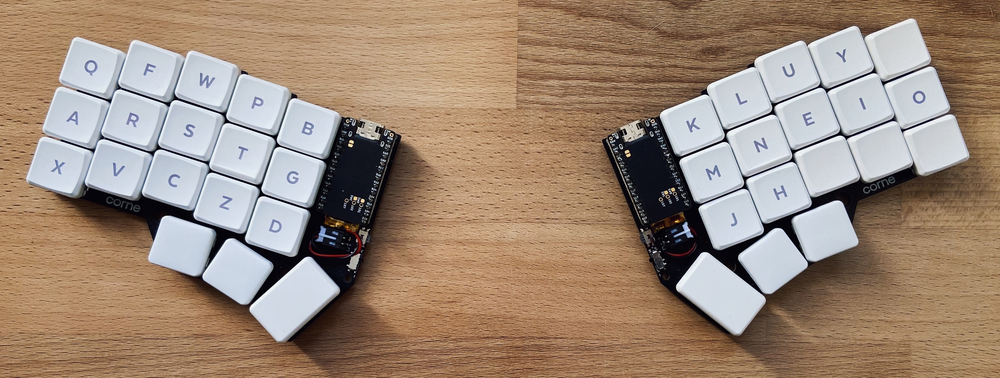

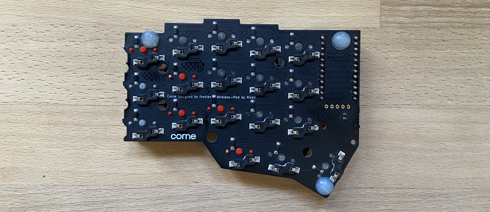


### Hardware

- five column Corne from [Typeractive][]
  - 36 keys
  - wireless
  - low profile
  - choc-spaced
  - hot-swappable
- no case, no plates, no displays — keeping it simple
- MBK Legend 40s keycaps from [splitkb][]
- linear Kailh Choc switches, also from [splitkb][]:
  - mostly silver (40gf)
  - pro red (35gf) near the outer edge
  - pink (20gf) under pinkies


### Software

- [Polemak][]: Colemak DH modified for Polish and Vim
- influenced by [Miryoku][]'s ideas and values
- home _low_ mods (using the index finger on the lower row for the fourth modifier instead of pinky)
- optimized for non-typing with just the left hand — with the right hand on the mouse/glass/... I can:
  - open specific apps
  - change tabs
  - copy, paste, close, reopen, undo, redo, ...
  - navigate system popups (tab, shift+tab, space, enter, esc)
  - call a fair amount of git commands (thanks to my short [aliases][git config])
  - quit CLI programs (ctrl+c, ctrl+d)
  - ...


## Layers

Layer images are auto-updated by `scripts/render`.

### Base

<picture>
  <source media="(prefers-color-scheme: light)" srcset="images/light/layers/base.webp">
  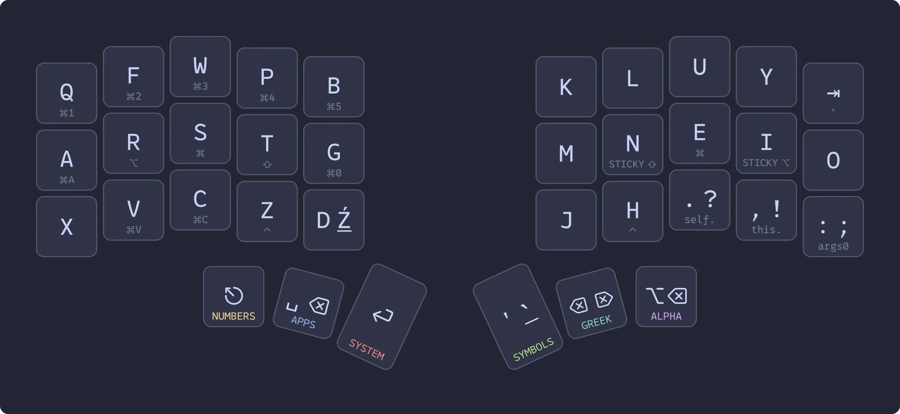
</picture>
<picture>
  <source media="(prefers-color-scheme: light)" srcset="images/light/layers/legend.webp">
  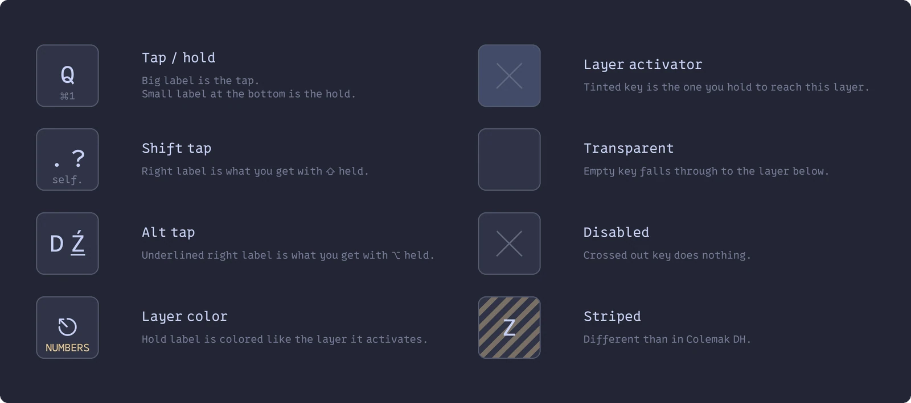
</picture>


### Polemak

Colemak DH modified for Polish and Vim

<picture>
  <source media="(prefers-color-scheme: light)" srcset="images/light/layers/polemak.webp">
  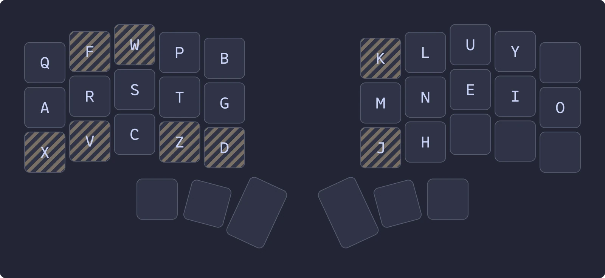
</picture>

- I write in English and Polish and I use Vim
- I started with Colemak DH (switching from QWERTY after three decades)
- swapped `J` and `K` so they're not up side down in Vim
- reorganized left bottom row for Polish:
  - in Polish `Z` is the most used consonant
  - `Q`, `V`, and `X` are not part of the alphabet
  - after my changes all `Z` digraphs are pleasant rolls: `CZ`, `DZ`, `RZ`, `SZ`
  - serendipitously, because I have `alt` on `hold R`, I can type `RZ` and `Ż` (same sound in Polish) using the same keys 🤯 just in a different rhythm
- swapped `F` and `W` so that closing windows is more convenient to me
- the whole time I was using Colemak DH [layout analysis tool][analyze] to make the layout better for Polish and not much worse for English:

| Layout | Finger effort | EN | PL | extra | Left hand | EN | PL |
| :-- | --: | --: | --: | --: | --: | --: | --: |
| QWERTY | 2,49 | 2,45 | 2,54 | **4%** | 55% | 55% | 54% |
| Colemak | 1,92 | 1,82 | 2,02 | 11% | 47% | 45% | 49% |
| Colemak DH | 1,86 | **1,73** | 2,00 | 16% | 47% | 45% | 49% |
| just JK | 1,86 | **1,73** | 2,00 | 15% | 47% | 45% | 49% |
| JK + XVCDZ | **1,85** | **1,73** | 1,96 | 13% | 47% | 45% | 49% |
| JK + XVCZD | 1,86 | 1,79 | 1,93 | 8% | 47% | 45% | 49% |
| JK + XCVZD | 1,88 | 1,80 | 1,96 | 9% | 47% | 45% | 49% |
| **JK + XVCZD + FW aka Polemak** | **1,85** | 1,79 | **1,91** | **6%** | 47% | 45% | 49% |


### Alpha layer

Just alphabet keys with no hold behaviours.

<picture>
  <source media="(prefers-color-scheme: light)" srcset="images/light/layers/alpha.webp">
  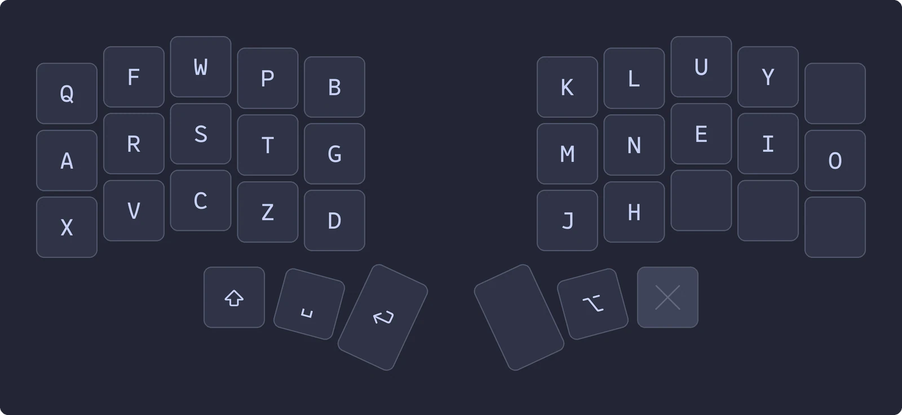
</picture>


### Greek layer

Greek characters using [urob/zmk-helpers](https://github.com/urob/zmk-helpers) and a Unicode hack on macOS: [Hammerspoon bindings](https://github.com/narfdotpl/dotfiles/commit/3fc93d50cc17e3a4dcf65a74143abaeaa2d14f0d) that toggle the [Unicode input source](https://github.com/narfdotpl/narf.pl/commit/4bab2c4219e701169b5905053d3f5fc19f7d1ae6).

<picture>
  <source media="(prefers-color-scheme: light)" srcset="images/light/layers/greek.webp">
  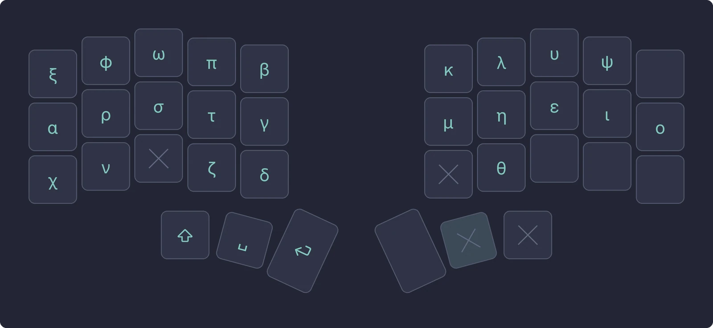
</picture>


### Apps and windows

Powered by [Hammerspoon][]:

<picture>
  <source media="(prefers-color-scheme: light)" srcset="images/light/layers/apps.webp">
  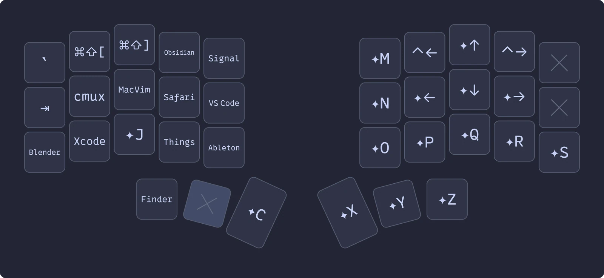
</picture>


### System

<picture>
  <source media="(prefers-color-scheme: light)" srcset="images/light/layers/system.webp">
  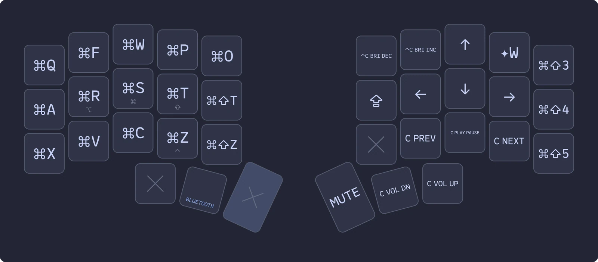
</picture>


### Bluetooth

<picture>
  <source media="(prefers-color-scheme: light)" srcset="images/light/layers/bluetooth.webp">
  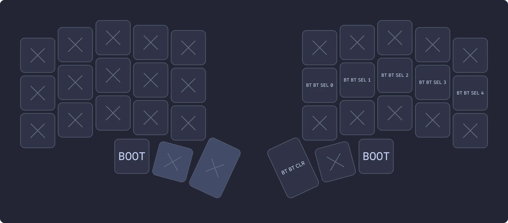
</picture>


### Symbols and code

<picture>
  <source media="(prefers-color-scheme: light)" srcset="images/light/layers/symbols.webp">
  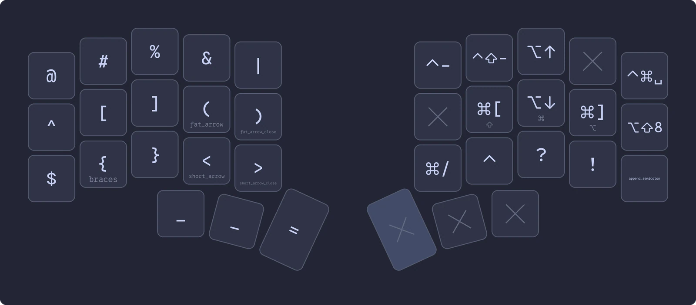
</picture>


### Numbers

<picture>
  <source media="(prefers-color-scheme: light)" srcset="images/light/layers/numbers.webp">
  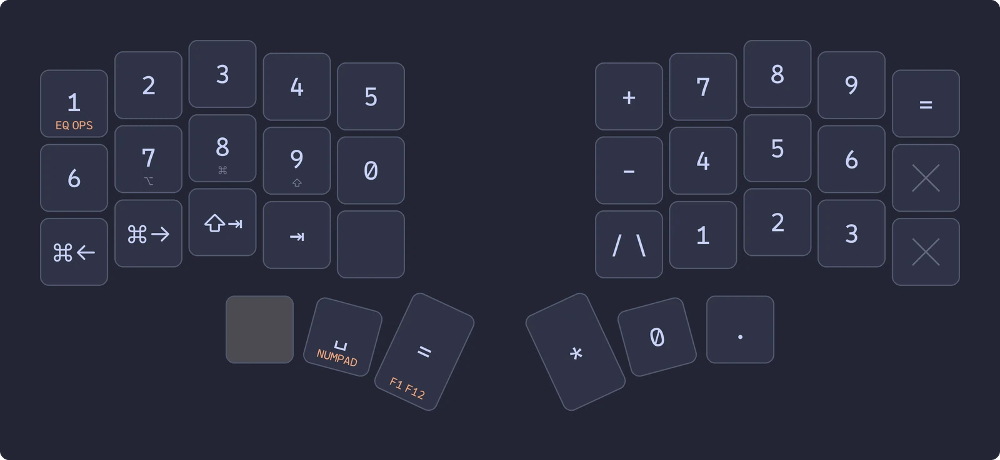
</picture>


### F1–F12

<picture>
  <source media="(prefers-color-scheme: light)" srcset="images/light/layers/f1_f12.webp">
  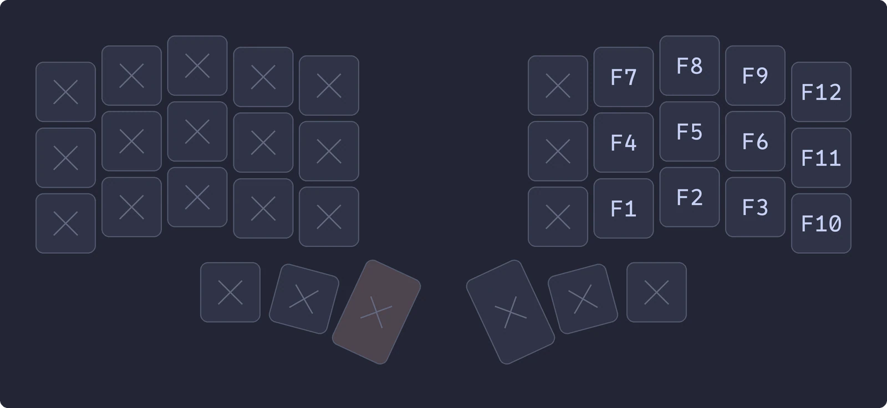
</picture>


### Numpad

<picture>
  <source media="(prefers-color-scheme: light)" srcset="images/light/layers/numpad.webp">
  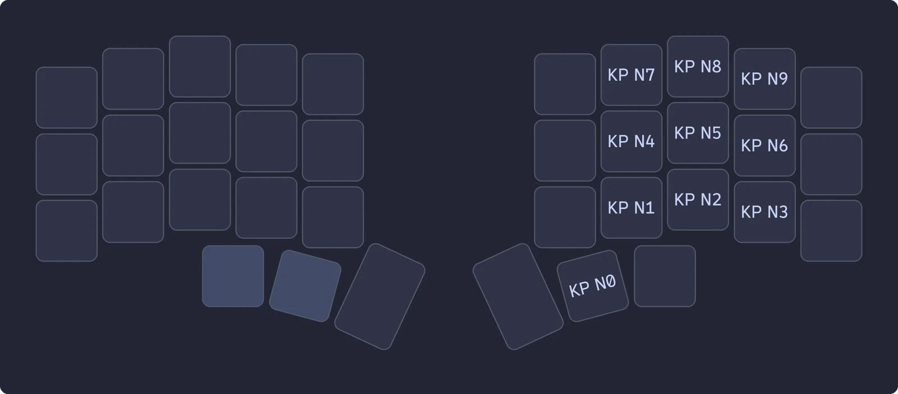
</picture>


### Equal operators

<picture>
  <source media="(prefers-color-scheme: light)" srcset="images/light/layers/equal_operators.webp">
  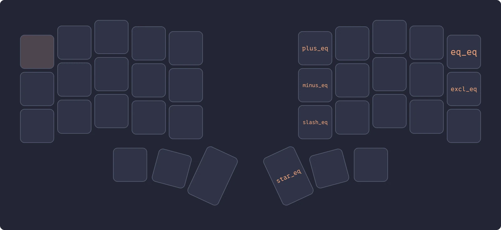
</picture>


## Building firmware locally

ZMK configs are designed for [building remotely using GitHub Actions][User Setup]. In my experience the remote build takes anywhere from a few minutes to an hour, depending on cloud weather, and as such is not acceptable for interactive development or experimentation. Therefore, I created a few scripts to automate building and flashing on my local machine. It takes about fourteen seconds.


### Environment

I use macOS, VS Code, and Docker Desktop. I followed the "VS Code & Docker" instructions described in the [Toolchain Setup][] section.


### Usage

```
./scripts/develop
```

1. Connect both halves to the Mac using USB-C.
2. Before flashing, reset first the right one, then the left one (volume names depend on the order).
3. Any time you save a file, the script will build and flash.


### Installation

```
cd ~/github
git clone git@github.com:narfdotpl/zmk-config.git
docker volume create --driver local -o o=bind -o type=none -o device="$HOME/github/zmk-config" zmk-config
cd zmk-config
git submodule update --init
brew install watchexec
```

Dependencies of the `scripts/render` script ([uv][], [ast-grep][], and the [0xProto][] font):

```
brew install uv ast-grep
brew install --cask font-0xproto
```

```
./scripts/develop
```

In the ZMK container:

```
west init -l app/
west update
```

Install [ZMK Tools][] VS Code plugin.

  [narf]: http://narf.pl
  [Typeractive]: https://typeractive.xyz
  [splitkb]: https://splitkb.com/
  [Polemak]: #polemak
  [Miryoku]: https://github.com/manna-harbour/miryoku
  [git config]: https://github.com/narfdotpl/dotfiles/blob/master/home/.config/git/config
  [analyze]: https://colemakmods.github.io/mod-dh/analyze.html
  [Hammerspoon]: https://github.com/narfdotpl/dotfiles/blob/master/home/.hammerspoon/init.lua
  [User Setup]: https://zmk.dev/docs/user-setup
  [Toolchain Setup]: https://zmk.dev/docs/development/setup
  [uv]: https://docs.astral.sh/uv/
  [ast-grep]: https://ast-grep.github.io/
  [0xProto]: https://github.com/0xType/0xProto
  [ZMK Tools]: https://marketplace.visualstudio.com/items?itemName=spadin.zmk-tools
